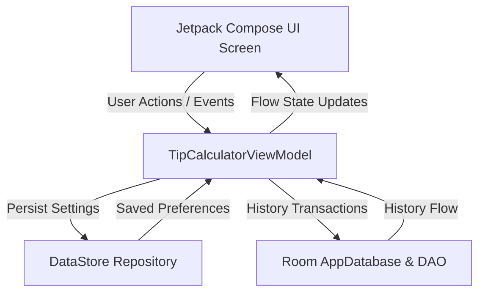

# Neon Tip Calculator ⚡

[](https://kotlinlang.org)
[](https://developer.android.com/jetpack/compose)
[](https://developer.android.com/topic/architecture)
[](LICENSE)

> **Build Small. Learn Big.** — *Small Code Lab*

**Neon Tip Calculator** is a portfolio-grade Android application designed for splitting bills and calculating tips effortlessly with a stunning dark neon aesthetic. Built using modern Android architecture components (**Kotlin, Jetpack Compose, Material3, MVVM, Hilt, Room, DataStore, Coroutines & Flow**).

---

## ✨ Features
- **Precise Money Arithmetic**: Uses `BigDecimal` with strict input sanitization to prevent floating point rounding errors.
- **Multi-Currency Support**: Switch between **USD ($)**, **EUR (€)**, **GBP (£)**, and **BDT (৳)** seamlessly.
- **Preset & Custom Tip Options**: Quick-select 10%, 15%, 20%, 25% or use the smooth **Custom Tip Slider (0% - 50%)**.
- **Round Up Per Person**: Toggle rounding per-person payment up to the nearest whole integer.
- **Persistent Settings (DataStore)**: Remembers your currency, last selected tip, and round-up preference.
- **Calculation History (Room DB)**: Save calculations into local Room database and view them anytime in a Modal Bottom Sheet.
- **Share Summary Sheet**: Instant plain-text export via native Android share sheet.
- **Adaptive Layouts**: Seamless single-pane portrait and two-pane landscape/tablet UI.
- **Full Localization**: Includes English & Bangla (`values-bn`) translations out-of-the-box.
- **Tactile Haptic Feedback**: Sensory touch feedback for interactive elements.

---

## 🏗️ Architecture & Tech Stack



- **UI Layer**: Jetpack Compose, Material3, Adaptive Layouts, Custom Animated Glow Canvas.
- **State Management**: StateFlow, Unidirectional Data Flow (UDF).
- **Dependency Injection**: Dagger Hilt (`@HiltAndroidApp`, `@HiltViewModel`).
- **Database**: Room Database with Flow observation and KSP code generation.
- **Preferences**: Preferences DataStore for lightweight key-value storage.

---

## 📁 Project Structure

```
com.smallcodelab.neontipcalculator/
├── data/
│   ├── currency/            # CurrencyOption Enum & symbols
│   ├── db/                  # Room Entity, DAO, and AppDatabase
│   └── preferences/         # UserPreferencesRepository (DataStore)
├── di/                      # Hilt Modules (DatabaseModule, PreferencesModule)
├── model/                   # TipOption & SplitAction enums
├── ui/
│   ├── screens/tipcalculator/
│   │   ├── components/      # ResultCard, CurrencySelector, CustomTipSlider, etc.
│   │   ├── TipCalculatorScreen.kt
│   │   ├── TipCalculatorUiState.kt
│   │   └── TipCalculatorViewModel.kt
│   └── theme/               # Color, Type, and Neon Dark Theme
└── MainActivity.kt          # Host Activity
```

---

## 🚀 How to Run
1. Clone this repository: `git clone https://github.com/smallcodelab/neon-tip-calculator.git`
2. Open in **Android Studio Ladybug** or newer.
3. Sync Gradle and run on an Android device/emulator (API 24+).

---

## 🗺️ Roadmap
- [x] Phase 1: Precision calculation & package audit
- [x] Phase 2: Room history, DataStore persistence & Hilt DI
- [x] Phase 3: Adaptive two-pane layouts & Splash Screen
- [x] Phase 4: Unit tests & Release build optimization
